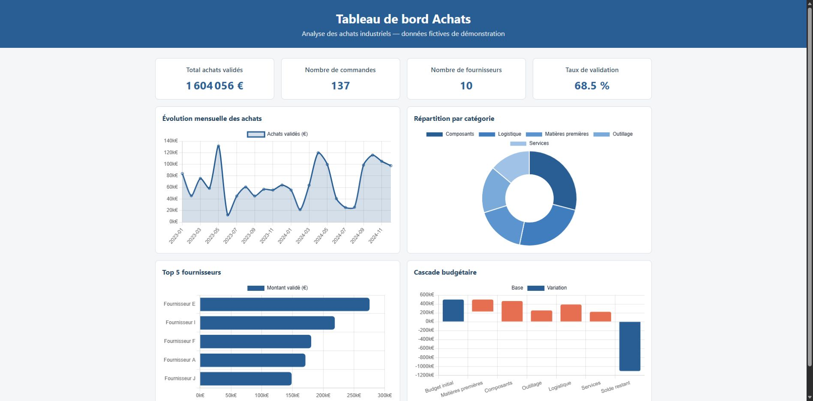
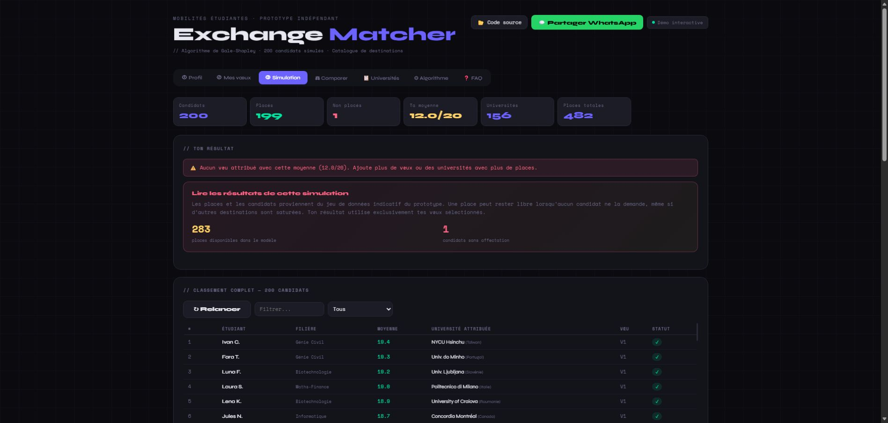
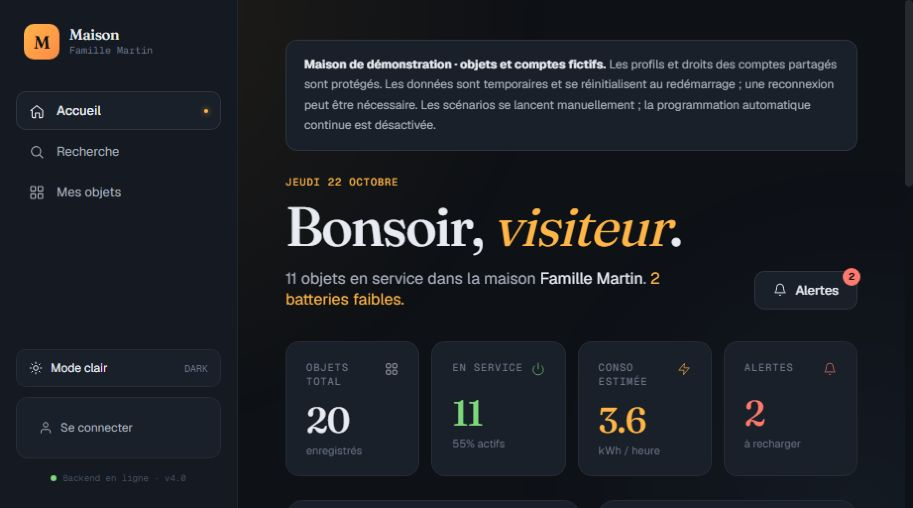
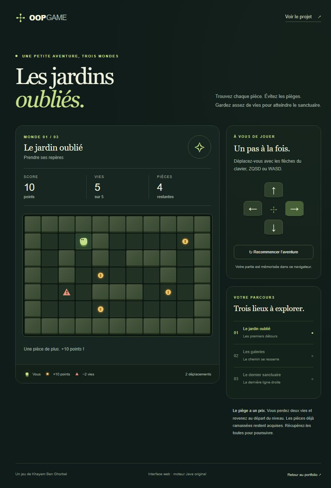
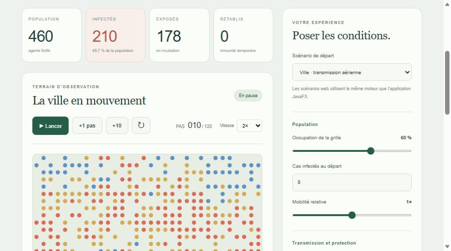

<div align="center">

# Khayem Ben Ghorbel
### IA · Données · Développement logiciel

Élève ingénieur à **CY Tech** — des projets à explorer, du code à lire, des idées à tester.

[](https://khayem-ben-ghorbel.vercel.app/)
[](https://khayem-ben-ghorbel.vercel.app/#projects)
[](https://www.linkedin.com/in/khayem-bg/)

**Stage de 4–6 mois dès mars 2027** · **Contrat de professionnalisation de 12 mois dès septembre 2027**

</div>

---

## Explorer les projets

**13 projets**, leurs technologies, leur contexte et les liens vers le code. Les boutons de démonstration ouvrent directement les applications hébergées : leur serveur, leur interface et leurs traitements réels. Français / anglais, thèmes clair / sombre, recherche et fiches détaillées.

| Application | Démo en ligne | Code |
| --- | --- | --- |
| **Reconnaissance ASL** | [Caméra guidée et prédiction du modèle](https://khayem-asl.vercel.app) | [Python / MediaPipe / scikit-learn](https://github.com/khayem487/asl-recognition) |
| **Pointage facial** | [Espace privé, pointage et suppression](https://khayem-facial-attendance.vercel.app) | [Python / Flask / OpenCV / Blob privé](https://github.com/khayem487/Facial-Recognition-Attendance) |
| **Loc Auto** | [Catalogue et réservation](https://khayem-car-rental.vercel.app) | [Java / Spring Boot / Thymeleaf](https://github.com/khayem487/car-rental-client) |
| **Dashboard Data Achats** | [Indicateurs et graphiques](https://khayem-data-dashboard.vercel.app) | [Python / Flask / Pandas](https://github.com/khayem487/data-dashboard) |
| **Exchange Matcher** | [Préférences et matching](https://khayem-exchange-matcher.vercel.app) | [JavaScript / Gale-Shapley](https://github.com/basstreche9/exchange-matcher) |
| **Maison Intelligente** | [Pièces, objets et scénarios](https://khayem-smart-home.vercel.app) | [Java / Spring Boot / React](https://github.com/khayem487/Dev-Web-ING-1-S2-public) |
| **OOP Game** | [Jouer la campagne de six cartes](https://khayem-oop-game.vercel.app) | [Moteur Java original / interface web](https://github.com/khayem487/oop-game-java) |
| **HealthRadar** | [Grille et courbes de simulation](https://khayem-healthradar.vercel.app) | [Moteur Java original / Canvas](https://github.com/khayem487/Sim_cell) |

Les autres projets sont présentés dans leurs fiches avec le code disponible. Un projet sans application déployée ne propose pas de faux bouton de démonstration. Exchange Matcher est un projet personnel initialement publié sous le pseudonyme [basstreche9](https://github.com/basstreche9), avec des candidats fictifs et sans connexion active à l’ENT.

<details>
<summary><strong>Aperçus des applications</strong></summary>

### Reconnaissance ASL


### Pointage facial


### Location de voitures


### Dashboard Data Achats


### Exchange Matcher


### Maison Intelligente


### OOP Game


### HealthRadar


Captures des interfaces des applications. Les illustrations SVG des autres cartes sont conceptuelles.

Les aperçus ASL et pointage facial ont été renouvelés le 30 octobre 2026 depuis les applications publiées. ASL utilise le vrai modèle, avec commandes caméra et guidage ; il classe des signes de l’alphabet sans traduire une conversation. Le pointage utilise OpenCV et Blob privé dans le cloud : chaque navigateur possède son espace, avec suppression des références et de l’historique. Cet espace n’est pas un compte utilisateur et le score de similarité ne garantit pas l’identité. Le mode local `face_recognition` reste distinct. Les captures montrent des espaces au repos, sans activer de webcam ni afficher de données personnelles.

</details>

## Développer

**React 19 · Vite 8 · CSS · Node.js 24**

```sh
npm ci
npm run dev -- --port 5180
npm run build
```

`npm run build` produit `dist/` pour Vercel. `npm run build:pages` prépare `/portfolio/` pour GitHub Pages.

| Fichier | Rôle |
| --- | --- |
| `src/data/projects.js` | Contenus bilingues et liens vers les applications |
| `src/App.jsx`, `src/styles.css` | Portfolio et fiches |
| `public/demo-previews/` | Captures des applications hébergées |
| `public/stage-demo/` | Parcours pédagogique du prototype de stage, clairement identifié |
| `public/demos/data-dashboard/` | Ancienne URL redirigée vers le vrai backend Flask/Pandas |

Le CV fourni est conservé sans modification : SHA-256 `864123f4d6e60d0084378d6c0d943f614699862401c1d8ab72415b039b39a631`.

## Publier

Projet Vercel : **khayem-ben-ghorbel**, relié à ce dépôt. Un push sur `master` déclenche le déploiement de production ; les autres branches produisent un aperçu. GitHub Pages est également construit par GitHub Actions.

Les deux branches distantes ont un rôle distinct : `master` contient les sources ; `gh-pages` contient les fichiers générés pour GitHub Pages. Cette dernière est exclue des builds Vercel pour éviter un déploiement inutile sans sources.

Pour une publication manuelle depuis le compte propriétaire :

```sh
npx vercel link --project khayem-ben-ghorbel
npm run build
node scripts/prepare-vercel.mjs
npx vercel deploy --prebuilt --prod
```

`.vercel/` et `.env*` sont exclus du dépôt. GitHub Pages construit la même interface avec le préfixe `/portfolio/`. Le contrôle des anciens sites Render reste déclenchable manuellement ; les pings planifiés ont été retirés après la migration Vercel.

## Vérifications

22 octobre 2026 : compilation de production, intégrité du CV et liens directs des huit applications contrôlés. Dashboard Data utilise ses API Flask/Pandas ; Exchange Matcher respecte les seuls vœux sélectionnés. Loc Auto V2 a été testé jusqu’au retour du véhicule, la maison utilise ses vrais contrôleurs Java, OOP Game ses classes Player/Level et HealthRadar ses six classes de modèle inchangées. Les anciennes URLs internes de démo renvoient vers le vrai site pour les projets hébergés, et vers la fiche pour les autres projets.

Les données de Loc Auto et de la maison restent temporaires. Les parties du jeu et les paramètres HealthRadar sont mémorisés dans le navigateur et recalculés par Java ; ce n’est pas un compte synchronisé entre appareils. Watch Party attend son stockage partagé, et le contrôle CROUS reste en revue tant que sa source ne permet pas un résultat utile.

---

<div align="center">

[Portfolio](https://khayem-ben-ghorbel.vercel.app/) · [GitHub](https://github.com/khayem487) · [Contact](mailto:khayembg07@gmail.com)

La première version utilisait [DeveloperFolio](https://github.com/saadpasta/developerFolio). L’historique conserve cette version ; la refonte actuelle utilise React et Vite.

</div>
