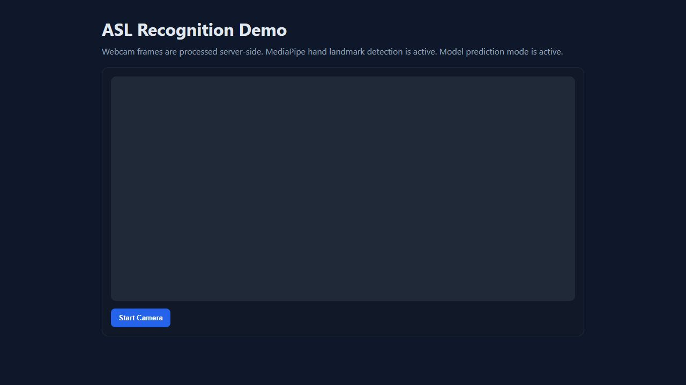
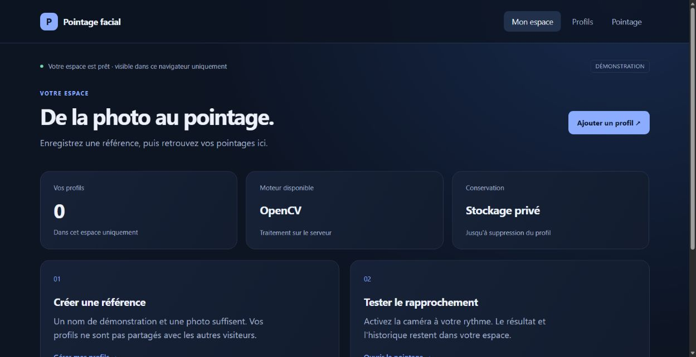

<div align="center">

# Khayem Ben Ghorbel
### IA · Données · Développement logiciel

Élève ingénieur à **CY Tech** — des projets à explorer, du code à lire, des idées à tester.

[](https://khayem-ben-ghorbel.vercel.app/)
[](https://khayem-ben-ghorbel.vercel.app/#projects)
[](https://www.linkedin.com/in/khayem-bg/)

**Stage de 4–6 mois dès mars 2027** · **Contrat de professionnalisation de 12 mois dès septembre 2027**

</div>

---

## Explorer les projets

**13 projets**, leurs technologies, leur contexte et les liens vers le code. Les boutons de démonstration ouvrent directement les applications hébergées : leur serveur, leur interface et leurs traitements réels. Français / anglais, thèmes clair / sombre, recherche et fiches détaillées.

| Application | Démo en ligne | Code |
| --- | --- | --- |
| **Reconnaissance ASL** | [Webcam et prédiction](https://khayem-asl.vercel.app) | [Python / MediaPipe / scikit-learn](https://github.com/khayem487/asl-recognition) |
| **Pointage facial** | [Inscription et pointage](https://khayem-facial-attendance.vercel.app) | [Python / Flask / OpenCV](https://github.com/khayem487/Facial-Recognition-Attendance) |
| **Loc Auto** | [Catalogue et réservation](https://khayem-car-rental.vercel.app) | [Java / Spring Boot / Thymeleaf](https://github.com/khayem487/car-rental-client) |

Les autres projets sont présentés dans leurs fiches avec le code disponible. Un projet sans application déployée ne propose pas de faux bouton de démonstration. Exchange Matcher est une participation au projet collectif dont le dépôt est maintenu par [basstreche9](https://github.com/basstreche9).

<details>
<summary><strong>Aperçus des applications</strong></summary>

### Reconnaissance ASL


### Pointage facial


### Location de voitures


Captures des interfaces des applications. Les illustrations SVG des autres cartes sont conceptuelles.

</details>

## Développer

**React 19 · Vite 8 · CSS · Node.js 24**

```sh
npm ci
npm run dev -- --port 5180
npm run build
```

`npm run build` produit `dist/` pour Vercel. `npm run build:pages` prépare `/portfolio/` pour GitHub Pages.

| Fichier | Rôle |
| --- | --- |
| `src/data/projects.js` | Contenus bilingues et liens vers les applications |
| `src/App.jsx`, `src/styles.css` | Portfolio et fiches |
| `public/demo-previews/` | Captures des applications hébergées |
| `public/stage-demo/`, `public/demos/data-dashboard/` | Présentations pédagogiques autonomes, distinctes des applications |

Le CV fourni est conservé sans modification : SHA-256 `864123f4d6e60d0084378d6c0d943f614699862401c1d8ab72415b039b39a631`.

## Publier

Projet Vercel : **khayem-ben-ghorbel**. Après connexion au compte propriétaire :

```sh
npx vercel link --project khayem-ben-ghorbel
npm run build
node scripts/prepare-vercel.mjs
npx vercel deploy --prebuilt --prod
```

`.vercel/` et `.env*` sont exclus du dépôt. GitHub Pages construit la même interface avec le préfixe `/portfolio/`. Le contrôle des anciens sites Render reste déclenchable manuellement ; les pings planifiés ont été retirés après la migration Vercel.

## Vérifications

20 octobre 2026 : compilation de production, intégrité du CV et liens directs des trois applications contrôlés. Les simulations ajoutées au portfolio ont été retirées. Les anciennes URLs internes de démo renvoient vers le vrai site pour les projets hébergés, et vers la fiche pour les autres projets.

---

<div align="center">

[Portfolio](https://khayem-ben-ghorbel.vercel.app/) · [GitHub](https://github.com/khayem487) · [Contact](mailto:khayembg07@gmail.com)

La première version utilisait [DeveloperFolio](https://github.com/saadpasta/developerFolio). L’historique conserve cette version ; la refonte actuelle utilise React et Vite.

</div>
