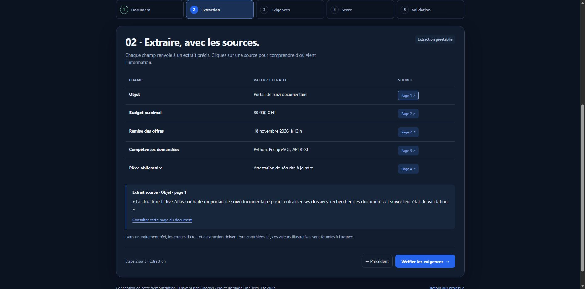
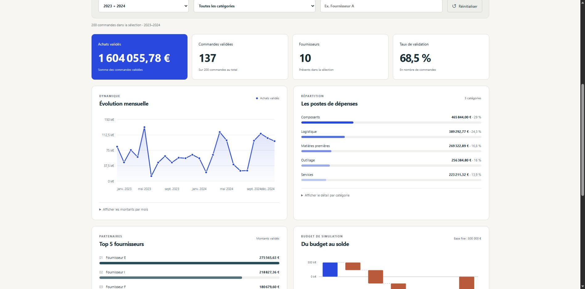

<div align="center">

# Khayem Ben Ghorbel
### IA · Données · Développement logiciel

Élève ingénieur à **CY Tech** — des projets à explorer, du code à lire, des idées à tester.

[](https://khayem-ben-ghorbel.vercel.app/)
[](https://khayem-ben-ghorbel.vercel.app/#projects)
[](https://www.linkedin.com/in/khayem-bg/)

**Stage de 4–6 mois dès mars 2027** · **Contrat de professionnalisation de 12 mois dès septembre 2027**

</div>

---

## Explorer les projets

**14 projets**, leurs technologies, leur contexte, les liens vers le code et un atelier interactif pour chacun. Français / anglais, thèmes clair / sombre, recherche et fiches détaillées.

| Projet | À essayer |
| --- | --- |
| **OneTech Tender Agent** | [Document → extraction → critères → décision](https://khayem-ben-ghorbel.vercel.app/#demo/onetech-tender-agent) |
| **Reconnaissance ASL** | [Explorer les repères de la main](https://khayem-ben-ghorbel.vercel.app/#demo/asl-recognition) |
| **Dashboard Data Achats** | [Filtrer les dépenses et les fournisseurs](https://khayem-ben-ghorbel.vercel.app/#demo/data-dashboard) |
| **Maison Intelligente** | [Piloter des pièces et des scénarios](https://khayem-ben-ghorbel.vercel.app/#demo/smart-home) |
| **Loc Auto** | [Parcourir le catalogue et réserver](https://khayem-ben-ghorbel.vercel.app/#demo/car-rental) |
| **Exchange Matcher** | [Comprendre l’affectation par préférences](https://khayem-ben-ghorbel.vercel.app/#demo/exchange-matcher) |

Les autres ateliers couvrent le pointage, HealthRadar, un jeu Java adapté au navigateur, les alertes CROUS, une relecture de données thermiques, des outils texte/PDF, la synchronisation vidéo et les recommandations de jeux.

<details>
<summary><strong>Deux aperçus des interfaces</strong></summary>

### Parcours documentaire


### Données et indicateurs


Ces captures présentent les interfaces de démonstration. Les illustrations SVG des cartes sont conceptuelles.

</details>

## Ce que les ateliers exécutent

Les ateliers fonctionnent dans le navigateur et utilisent des données de démonstration. Leur périmètre est indiqué dans l’interface.

- **OneTech** : parcours fictif, extraction préétablie ; aucun LLM ni OCR exécuté.
- **Data Achats** : adaptation du jeu synthétique public, filtres et agrégats vérifiés. [Provenance et méthode](public/demos/data-dashboard/README.md).
- **ASL et pointage** : repères synthétiques et parcours fictif ; la reconnaissance caméra reste dans les applications Python liées.
- **Autres ateliers** : adaptations pédagogiques JavaScript ; les serveurs Java/Python, modèles privés, scraping, Telegram et WebSockets d’origine ne sont pas exécutés ici.
- **Fan Control** : données synthétiques uniquement, sans lecture ni commande matérielle.

Les trois applications Render restent accessibles via **Application serveur** ; elles n’ont pas été migrées sur Vercel. Exchange Matcher est attribué au projet collectif dont le dépôt est maintenu par [basstreche9](https://github.com/basstreche9) ; son atelier est une implémentation pédagogique distincte.

## Développer

**React 19 · Vite 8 · CSS · Node.js 24**

```sh
npm ci
npm run dev -- --port 5180
```

```sh
npm run build
node public/demos/data-dashboard/verify_data.cjs
```

`npm run build` produit `dist/` pour Vercel. `npm run build:pages` prépare `/portfolio/` pour GitHub Pages.

| Fichier | Rôle |
| --- | --- |
| `src/data/projects.js` | Contenus bilingues et liens |
| `src/App.jsx`, `src/styles.css` | Portfolio et fiches |
| `src/DemoLab.jsx`, `src/lab.css` | Navigation et thème commun des ateliers |
| `src/demos/` | Interactions dans le navigateur |
| `public/stage-demo/`, `public/demos/data-dashboard/` | Deux ateliers autonomes |

Le CV fourni est conservé sans modification : SHA-256 `864123f4d6e60d0084378d6c0d943f614699862401c1d8ab72415b039b39a631`.

## Publier

Projet Vercel : **khayem-ben-ghorbel**. Après connexion au compte propriétaire :

```sh
npx vercel link --project khayem-ben-ghorbel
npm run build
node scripts/prepare-vercel.mjs
npx vercel deploy --prebuilt --prod
```

`.vercel/` et `.env*` sont exclus du dépôt. Le workflow GitHub Pages construit la même interface avec le préfixe `/portfolio/`. Le workflow de disponibilité des anciennes applications Render est conservé séparément.

## Vérifications

20 octobre 2026 : compilation de production, agrégats du dashboard, intégrité du CV, chargement des 14 ateliers et une interaction représentative par atelier contrôlés. Les adaptations ASL et pointage n’attestent pas du fonctionnement des modèles caméra. Les applications Render n’ont pas fait l’objet d’un nouvel audit fonctionnel.

---

<div align="center">

[Portfolio](https://khayem-ben-ghorbel.vercel.app/) · [GitHub](https://github.com/khayem487) · [Contact](mailto:khayembg07@gmail.com)

La première version utilisait [DeveloperFolio](https://github.com/saadpasta/developerFolio). L’historique conserve cette version ; la refonte actuelle utilise React et Vite.

</div>
